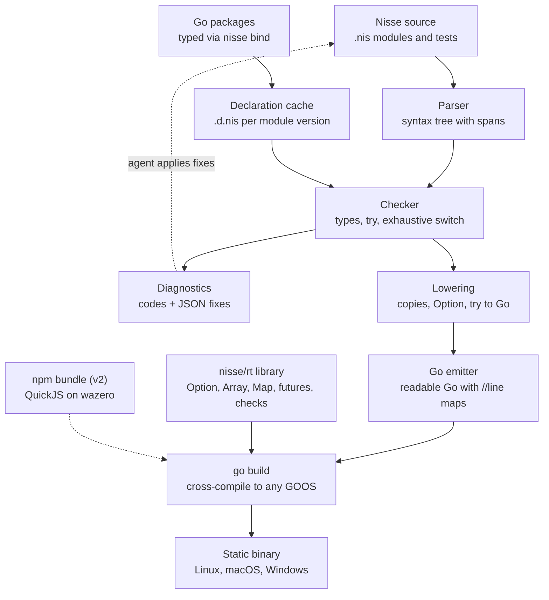

# Nisse: TypeScript-shaped language on Go — PRD & build plan

Oct 19, 2026 · revised Oct 20 after design review and the spike decisions, and Oct 24 after an evaluation of whether the plan is worth doing ([evaluation](evaluation/2026-10-24-worth-it.md); see [Review log](#review-log))

## Summary

Nisse is a strict, TypeScript-shaped language for coding agents that compiles to readable Go and ships as a single static binary. It keeps the agent-friendly ideas introduced by [Tov](https://github.com/richiemcilroy/Tov): familiar TS syntax, no `any`/`null`/`==`, every fallible call marked `try`, and compiler errors that return machine-applicable fixes. Unlike Tov, it does not own a native runtime. Go provides the GC, scheduler, networking, TLS and cross-compilation.

The bet: agents know TypeScript syntax deeply, Go runs servers well, and a strict checker with stable error codes and machine-applicable fixes, run in a tight loop, raises agent task success more than either language's own toolchain does. The evidence ([evaluation](evaluation/2026-10-24-worth-it.md)) supports the loop but not TypeScript fluency as the source of the gain: on repository-level agent benchmarks TypeScript is among the weakest languages and Go is roughly level with it (SWE-bench Multilingual: JS/TS 34.9%, Go 31.0%). So the advantage has to come from the checker and its fixes, and it is unproven until the Phase 0 experiment (W1-14) measures it. v1 targets backend services and CLIs written fresh in Nisse. Go packages are first-class imports; npm is an opt-in escape hatch through an embedded JS engine.

The long-term goal goes further: take a complex existing TypeScript app (a Node backend, its npm dependencies, even its SSR frontend) and reproduce it on the Go runtime. Two things get there together. `nisse port` translates a TypeScript codebase into Nisse, and later waves widen Nisse towards TypeScript parity without giving up the strict checker. See [TypeScript parity](#typescript-parity-v2-and-later).

**Design rule that follows from the bet:** where Nisse behaves differently from TypeScript, the difference must be *loud*, never *silent* (same code, different result). Loud means a compile error with a fix, or, where only the runtime can know, a trap that names the Nisse source line. Each divergence below says which kind it is. A few divergences cannot be made loud without banning core features; they are listed under [Accepted divergences](#accepted-divergences), each with a warning or a `port` diagnostic where one is possible, a line in `llms.txt`, and a suite task that probes it.

The work is tracked item by item in the [ledger](ledger/README.md).

## Problem and opportunity

Agents produce a lot of backend code, and the languages they write best are the ones that fail most quietly. TypeScript allows `any`, implicit coercion and unmarked throws. Errors come back as prose an agent has to interpret, so fix loops are slow and guessy. Go is strict and operationally excellent, and agents resolve Go issues at about the same rate as TypeScript issues, but its verbose error handling and `nil` leave quiet bugs the compiler does not catch.

Tov shows interest in a middle path: 753 GitHub stars at version 0.0.1 two weeks after launch (Oct 24, 2026), from one committer; its two Hacker News posts drew 4 and 3 points, and its "faster than Rust" benchmarks were publicly disputed on Oct 22, 2026. That is curiosity, not proof of demand; the Phase 0 experiment and the task suite are the demand test. Tov also shows the cost: a custom C runtime, its own HTTP server and TLS integration, and an embedded JavaScriptCore. That is a large surface to keep correct and secure, and it does not run on Windows yet. On running existing TypeScript it is ahead of this plan: its spec already compiles `.ts` files, keeps UTF-16 string semantics, and runs Node and Bun APIs and npm packages, native addons included, on the bundled JavaScriptCore.

The slot next door is taken by large players. Anthropic acquired Bun in Dec 2025 and ships Claude Code as a Bun-compiled binary, so `bun build --compile` (and `deno compile`) already turn TypeScript into one executable. Cloudflare absorbed the Deno team on Oct 9, 2026. Nisse is therefore not a runtime business: it is a compiler and checker that rides Go's toolchain, and its wedge is what a JS runtime cannot offer, namely typed Go imports, readable Go output, no JS engine in the binary, and cross-compilation to every OS from one machine. The buyer is a team that runs, or wants to run, Go services and whose agents write TypeScript more reliably than they write Go.

Nisse takes the same front end and hands the back end to Go:

- **Production runtime for free.** Go's scheduler, GC, `net/http`, TLS, pprof and race detector are mature and memory-safe.
- **Distribution for free.** `GOOS`/`GOARCH` cross-compilation covers Linux, macOS and Windows from one machine.
- **Ecosystem for free.** Every Go module becomes a typed import.
- **Trade-off accepted.** Lower peak throughput and higher memory than a hand-tuned C runtime, and no drop-in npm compatibility. Against Bun the memory trade reverses: a Bun binary carries JavaScriptCore, while a Go hello-world is a few MB; benchmarks report both.

## Goals, non-goals and users

**Primary user:** a developer who has a coding agent write and maintain backend services and CLIs, and who wants the output to be safe, fast and easy to deploy. **Secondary user:** the agent itself, which consumes the docs, diagnostics and fixes.

**Goals for v1**

1. An agent given only `llms.txt` and the `nisse check --json` / `nisse fix` loop reaches a passing build on the task suite at least as often as the same agent on Go with `go vet`, and within 5 points of it on strict TypeScript with `tsc`. Always measured with the loop, never one-shot: studies of unfamiliar languages show one-shot success from a spec alone stays far below familiar languages, while compiler feedback gives the big gains.
2. Every compile error has a stable code, and most common ones ship a machine-applicable fix.
3. Generated Go is readable, idiomatic enough to debug, and maps back to Nisse source lines.
4. HTTP services and CLIs build to one static binary for Linux, macOS and Windows.
5. Any Go package can be imported with types, without hand-written bindings.

**Long-term goals (v2 and later)**

6. `nisse port` turns a complex TypeScript backend into a Nisse project that passes the original's test suite and answers recorded traffic identically, with an agent finishing what the tool could not.
7. The npm packages such apps depend on work, either mapped to Go-native equivalents or run in the embedded JS engine.
8. Full-stack apps, including server-rendered React frontends, ship as one binary.

**Non-goals for v1**

- Running npm packages or Node apps. The parity line takes this on through `nisse port`, never by running Node apps unchanged.
- Beating Go or Rust on raw benchmarks.
- Frontend, browser or WASM-in-the-browser targets (v1 only; see [Frontend and SSR](#frontend-and-ssr)).
- 32-bit targets (`GOARCH=386`, `arm`, `wasm`). v1 ships `amd64` and `arm64` only.
- A package manager of its own (Go modules are the package manager).
- Full TypeScript compatibility. The parity waves add most TypeScript features back with defined Go lowerings; the few that cannot be made safe stay out for good (see [Never supported](#never-supported)).

## Language requirements

Nisse keeps TypeScript's syntax and drops what makes programs hard to reason about. Each feature below has a defined Go lowering; anything without one is out of v1. The rules behind each row are spelled out in [Semantics](#semantics).

| Nisse feature | Rule | Lowers to Go |
| --- | --- | --- |
| `int`, `f64`, `string`, `bool` | `int` and `f64` are distinct; no implicit conversion; overflow traps | `int` (64-bit on every v1 target), `float64`, `string`, `bool`; checked arithmetic via inlinable `rt` helpers, elided where provably safe |
| Sized ints `i8`–`i64`, `u8`–`u64`, and `f32` | For Go interop and byte work; overflow traps | `int8`–`int64`, `uint8`–`uint64` |
| Strings | UTF-8; every offset is a byte offset; no `.length`, no `s[i]` | `string` |
| Records `{ a: int }` | Value semantics; structural typing; `===` compares fields | Named structs (anonymous shapes get generated names); field-wise conversion between equal shapes |
| Tuples `[A, B]` | Fixed length; value semantics | Generated structs with positional fields |
| Destructuring and spread | Object and array destructuring with defaults and `...rest`; object spread into records; array spread | Field reads, struct construction, `rt` array helpers |
| Arrays `T[]`, `Map<K,V>`, `Set<T>` | Value semantics via copy-on-write; `Map`/`Set` keep insertion order | `rt.Array[T]`, `rt.Map[K,V]`, `rt.Set[T]` |
| Built-in methods (`map`, `filter`, `get`, …) | Generic intrinsics known to the compiler | `rt` free functions or inline loops |
| Classes | Reference semantics; no `extends`; `implements` checked | Pointer to struct plus methods; `var _ I = (*C)(nil)` assertions |
| Interfaces | Structural; no generic methods | Go interfaces |
| Tagged unions | Discriminated by a shared literal field; must narrow; `switch` exhaustive | Sealed interface + one struct per variant; type switch |
| Literal unions `"a" \| "b"` | Replace `enum`; `switch` exhaustive | Named string/int type + constants |
| Untagged unions `string \| int`, `A \| B` | Members must be distinguishable at runtime; narrow with `typeof`/`instanceof` | Sealed interface with wrapper types |
| Optional `T \| undefined`, `a?: T` | No `null`; must narrow; `?.` and `??` supported | `rt.Option[T]` generic struct |
| `try f()` / `throws E` | Fallible calls marked; errors part of the type | `(T, error)` returns with typed error values; `try` = early return |
| `throw`, `try { } catch (e) { }` | `e` is the union of thrown types; narrow it; types not handled must be rethrown or declared in `throws` | Type switch on Nisse error types; `errors.As` only for `GoError` |
| Generics (functions, types, class methods) | Generic methods allowed on classes (Go 1.27); not on interfaces | Go type parameters; class generic methods lower to Go 1.27 generic methods; structurally constrained generics (`T extends { name: string }`) are monomorphised or rejected, decided in W3-20 |
| `async`/`await`, `spawn`, `Promise<T>` | Structured concurrency; no floating promises; cancellation built in | Goroutine + `rt.Future[T]`; `context.Context` threaded through; `Promise.all` = errgroup-style join implemented in `rt` |
| `const`, `let`, `readonly` | `const` is deeply immutable for value types | Compile-time only |
| `inout` params, `&x` | Explicit mutation of caller's value | Pointer parameters |
| Modules `import`/`export` | One directory = one module = one Go package; no import cycles | Package per directory, mangled names (see [Names](#names-in-generated-go)) |
| `test("…", () => …)` | Built-in tests | Generated `_test.go` functions |

**Removed from TypeScript in v1:** `any`, `null`, `==`/`!=`, implicit coercion (including truthiness), `var`, prototypes, class inheritance (`extends` on classes), decorators, `enum` (use literal unions), function overloads, declaration merging, getters/setters with side effects, `eval`. Each removed construct has a dedicated diagnostic with a fix or a pointer to the replacement. Most of them come back in the parity waves ([Language additions](#language-additions)); the rest are [never supported](#never-supported).

**Semicolons:** optional, with TypeScript's automatic semicolon insertion rules, so any program parses as it does in TypeScript (D-12). The cases where a newline changes meaning (`return`, `throw`, `break` followed by a newline) are errors with a fix, since they almost never do what was meant.

**Source mapping:** every generated Go file carries `//line` directives, so panics, stack traces, `go vet` output and the debugger point at Nisse lines.

### Semantics

These rules settle the places where TypeScript and Go disagree. Each one either matches TypeScript or fails loudly.

#### Values and aliasing

Records, arrays, `Map` and `Set` are values: `const b = a` gives `b` its own copy. This is what makes concurrency safe (a value sent to a task cannot be mutated behind its back) and what keeps reasoning local. It is also the biggest divergence from TypeScript, so it is backed by five things:

1. **`const` is deeply immutable** for value types (see below), so `const b = a; b.push(x)` is a compile error, not a silent copy. Most aliasing in agent code goes through `const`.
2. **Alias warning.** When a `let` copy is mutated and the original is read afterwards, the checker warns (`W`-code) that the original is unchanged, with fixes to use `inout`, a class, or to silence by writing `a.clone()` (an intrinsic on value types) to make the copy explicit.
3. **Parameters are `const`.** Mutating a value-typed parameter (`xs.push(1)` inside `add(xs)`) is an error with fixes `inout xs` (with `&list` at call sites) or copying into a `let`. This makes the copy at a Nisse call boundary loud; without it, the most common TypeScript aliasing pattern would silently change meaning.
4. **Copy-on-write lowering.** `rt.Array[T]` shares its backing store on assignment and copies on the first mutation through a shared handle. The sticky "shared" bit lives in the backing store's header, not the handle, and the lowering must set it at every place Go copies a value containing a collection handle: assignment, call, return, `range`, closure capture, interface boxing and container insert. W4-04 enumerates those sites and measures the cost before Phase 1 is sized. It is race-free for values not reachable through a class instance shared between tasks; for those, the class's own race applies (D-05) and `--race` reports it. The checker also elides copies when the source is never mutated after the copy.
5. **`llms.txt` leads with it.** The first section of the spec is "values are copied".

The cost is that the TypeScript habit `const xs: T[] = []; xs.push(x)` is an error, with the safe `const` → `let` fix. The suite measures how often it fires; it is expected to dominate the first-check diagnostics at first.

Classes are references, as in TypeScript. Use a class when sharing is the point.

Passing a value to a Go function copies it at the boundary unless the binding marks the parameter as borrowed (see [Interop](#interop)).

#### Bindings and mutability

- `let` bindings can be reassigned and mutated.
- `const` bindings cannot be reassigned, and for value types nothing reachable through them can be mutated. Reachability stops at a class reference: fields of a class instance held in a `const` record stay mutable. Mutating through a `const` is an error with a safe fix: change `const` to `let`.
- For classes, `const` fixes the binding only; fields stay mutable unless marked `readonly`.
- `readonly` fields on records and classes are assignable only in the literal or constructor.

#### Numbers

- Integer literals are `int`; literals with a `.` or exponent are `f64`. A literal takes the type its context expects (`const x: f64 = 1` is fine, as in Go).
- No implicit conversion between numeric types. Mixed arithmetic (`int + f64`) is an error with fixes `f64(a)` or `int(b)` (a checked conversion that traps on a fraction or overflow).
- `int / int` is an error, because TypeScript gives `3.5` where Go gives `3`. Fixes: `f64(a) / f64(b)` or `Math.idiv(a, b)`. `%` on integers is allowed (it truncates in both languages).
- Overflow, division by zero and out-of-range conversion trap. Wrapping arithmetic is available explicitly (`Math.wrappingAdd`, …).
- Conditions must be `bool`. `if (x)` on an optional, number or string is an error with a safe fix (`x !== undefined`, `x !== 0`, `x !== ""`).

#### Strings

Nisse strings are Go strings: immutable UTF-8 bytes. JavaScript strings are UTF-16, so `.length`, `s[i]` and `charCodeAt` give different answers for non-ASCII text. Instead of diverging silently:

- `s.length` is an error with fixes `s.byteLength` (`safe` when compared with `0`, `maybe` otherwise) and `s.runeCount()`.
- `s[i]` is an error with fixes `s.byteAt(i)` and `s.runes()[i]`.
- Every offset-taking or offset-returning method (`slice`, `indexOf`, `substring`, …) works in byte offsets. The same call compiles in TypeScript with UTF-16 meaning, so this is an [accepted divergence](#accepted-divergences): the checker warns (`W`-code) when a non-ASCII literal, or an offset computed from one, reaches one of these methods.
- `for (const ch of s)` iterates code points, like Go's `range`.

#### Equality and map keys

- `===` and `!==` require both sides to have the same type.
- Value types (primitives, records, arrays, maps, sets, unions) compare structurally. Lowering uses Go `==` where the type is comparable and a generated `Equal` method otherwise. TypeScript compares objects by identity, so `{a: 1} === {a: 1}` is `true` here and `false` there; records have no identity in Nisse, so this is an [accepted divergence](#accepted-divergences).
- Classes compare by identity. Functions are not comparable.
- `Map` keys and `Set` elements must be primitives, literal unions, records/unions of such fields, or classes (by identity). Arrays, maps and functions as keys are an error. Record keys are compared by value, unlike JavaScript's object identity: another [accepted divergence](#accepted-divergences).

#### Collections

- `Map` and `Set` iterate in insertion order, as in JavaScript. Go maps are randomly ordered, so `rt.Map` pairs a Go map with an ordered index.
- `xs[i]` returns `T` and traps when out of range (TypeScript would return `undefined`). `xs.at(i)` returns `T | undefined`. `m.get(k)` returns `V | undefined`.
- Records have fixed fields; there is no `Object.keys` on records. Dynamic keys use `Map`.

#### Unions

- A union of records is *tagged* when every member has a field of the same name with a distinct literal type. Any field name works; `kind` is the convention.
- Literal unions (`"get" | "post"`, `1 | 2 | 3`) replace `enum` and lower to a named Go type with constants.
- Untagged unions are allowed only when the members can be told apart at runtime: distinct primitives, classes, or tagged records. A union of untagged records is an error with a fix that adds a `kind` field.
- `switch` over a union or literal union must be exhaustive; the fix inserts the missing `case`s.

#### Errors

- An error type is a class or record that implements `Error` (a `message` field or method). It lowers to a Go type with an `Error() string` method.
- `throws A | B` lists what a function can throw. Calling a fallible function requires `try`; the fix inserts it. A function that lets an error escape must list it; the fix adds it to `throws`.
- `catch (e)` types `e` as the union of what the `try` block throws. Narrow with `instanceof` or `switch`; anything not handled must be rethrown or listed in the enclosing `throws`.
- Functions bound from Go throw `GoError`, which exposes `is`/`as` helpers over Go's `errors` package.
- **Traps are not errors.** Overflow, out-of-range index, failed `as` conversion and failed boundary nil checks are Go panics with a Nisse-level message and a Nisse source location. They cannot be caught by `catch`. Go's own boundaries still contain them: a trap inside an HTTP handler aborts that request only (`net/http` recovers it) and is logged with the Nisse location, and a trap in `test()` fails that test. `nisse:http` lets the user install a trap hook.

#### Classes, methods and generics

- No class inheritance. Use interfaces plus composition. `extends` on a class is an error that points at the composition pattern.
- Method values bind their receiver (`arr.forEach(obj.handle)` works), unlike JavaScript's unbound `this`. This divergence can only turn a JavaScript bug into working code, so it stays.
- Go 1.27 allows generic methods on concrete types but not on interfaces, and a generic method cannot satisfy an interface method. So Nisse classes may declare generic methods, which lower to Go 1.27 generic methods; a generic method on an interface is an error with a fix that turns it into a free function. Go type parameters cannot read struct fields, so generics constrained by fields (`T extends { name: string }`) are monomorphised (one Go function per instantiation) or rejected with a fix; W3-20 decides which.
- The built-in methods on arrays, maps, sets, strings, options and promises (`map`, `filter`, `reduce`, `find`, `flatMap`, `sort`, …) are compiler intrinsics with generic signatures. They lower to `rt` free functions or inline loops, so the idioms agents rely on keep working.

#### Concurrency

- An `async` function call must be `await`ed, passed to `Promise.all`/`Promise.race`/`Promise.allSettled`, or started with `spawn`. A floating call is an error.
- `const p = spawn work()` starts a task and returns a `Promise<T>`. Every spawned task belongs to the enclosing async scope; the scope does not return until its tasks finish, and the checker reports a task that is never awaited.
- Every async function receives a `context.Context` in the lowering. `await` observes cancellation. `Promise.all` cancels the siblings when one fails; JavaScript lets them run on, so this is an [accepted divergence](#accepted-divergences), and `Promise.allSettled` keeps JavaScript's behaviour. `nisse:context` exposes `timeout`, `deadline` and `cancelled()`.
- `main` and `test` bodies may be `async`.
- Values are copied into tasks, so they cannot race. Class instances shared between tasks can; v1 relies on Go's race detector (`nisse test --race`) and revisits the policy after Phase 3.

#### Names in generated Go

Go decides visibility by capitalisation, TypeScript by `export`. The emitter maps names deterministically:

- Exported names get an upper-case first letter (`export function parse` → `Parse`).
- Non-exported names that start upper-case get a `_` prefix (`type Shape` → `_Shape`), which Go treats as unexported.
- Two exported names that collide after capitalisation (`foo` and `Foo`) are a Nisse error, not a Go error.
- Names that clash with Go keywords or predeclared identifiers (`type`, `func`, `len`, `string`, …) get a `_` suffix.
- Public members of any type (methods and fields not marked `private`/`#`) get an upper-case first letter, whether or not the type is exported, so they can be called across packages and can satisfy Go interfaces (`serveHTTP` → `ServeHTTP` implements `http.Handler`).
- Record fields are always exported in Go and carry a `json:"originalName"` tag, so JSON and cross-package access work. `private`/`#` class fields stay unexported.

#### Accepted divergences

These differences from TypeScript cannot be made into compile errors without banning core features. Each is documented in the `llms.txt` core, probed by a suite task, and counted by the silent-divergence metric (target 0 incidents):

| Divergence | Why it stays | What makes it visible |
| --- | --- | --- |
| `===` on records, arrays and maps compares contents, not identity | Records have no identity in Nisse | `llms.txt`; `nisse port` emits a `port` diagnostic wherever it rewrites an object-identity comparison |
| Records as `Map` keys and `Set` elements compare by value | Same reason | `llms.txt`; `port` diagnostic on object-keyed maps |
| String methods take and return byte offsets | Go strings are UTF-8; UTF-16 views exist in the parity line | `W`-code warning when a non-ASCII literal or an offset derived from one reaches these methods |
| `Promise.all` cancels the other tasks when one fails | Structured concurrency; JavaScript's siblings keep running | `llms.txt`; `Promise.allSettled` keeps JavaScript's behaviour |

Traps (out-of-range index, overflow, failed conversion) are loud runtime differences, not accepted divergences: they stop with the Nisse source line instead of carrying on with a wrong value.

## Toolchain and agent-facing requirements

The diagnostics are the product: every requirement here serves a tight write → check → fix loop for agents.

**CLI (`nisse`)**

| Command | Does |
| --- | --- |
| `nisse check [path] [--json]` | Type-check only; JSON diagnostics for tools |
| `nisse fix [path] [--safe-only]` | Apply machine-applicable fixes |
| `nisse explain E0831` | Long-form explanation and examples for an error code |
| `nisse run file.nis` | Build and run `main()` |
| `nisse build -o app [--target linux/arm64]` | Emit Go, invoke `go build`, write one binary |
| `nisse test [--race]` | Run `test(...)` blocks via `go test` |
| `nisse emit [-o dir]` | Write the generated Go for inspection |
| `nisse bind <go-module>` | Generate typed Nisse declarations for a Go package |
| `nisse --watch` | Rebuild and restart on change |
| `nisse fmt [path]` | Rewrite files in the one canonical layout, so fixes and diffs stay small |
| `nisse init` | Scaffold `go.mod`, `main.nis` and `AGENTS.md` in an empty directory |

**Diagnostics contract**

- Stable codes, never reused: `E` + 4 digits for errors, `W` + 4 digits for warnings. Each has an `explain` page. Codes are grouped by area: `0xxx` syntax and removed TypeScript features, `1xxx` names and modules, `2xxx` types and numbers, `3xxx` unions and narrowing, `4xxx` errors and `try`, `5xxx` values and mutability, `6xxx` concurrency, `7xxx` interop.
- Human output: location, message, one-line why, alternatives.
- JSON output: `code`, `file`, `start`/`end`, `message`, and `fixes[]` with `label`, `applicability` (`safe` | `maybe` | `manual`) and exact text `edits[]`. The schema is versioned and published.
- Errors in generated Go are a compiler bug, never user-facing. CI enforces this by compiling every checker test that passes and by fuzzing.
- Check latency: under 500 ms for a warm 10k-line project, where warm means a long-running process (`--watch` or the language server) with the project and bound declarations resident. A cold `nisse check` from the command line stays under 2 s on the reference runner. A check that has to bind new Go imports may take longer, and reports that it is doing so.

**Agent docs**

- `llms.txt` in two layers: a core of at most ~3k tokens holding the divergences from TypeScript, each as a one-line rule plus a wrong → right example pair, ordered by how often they fire in the suite; and a reference of at most ~12k tokens. Examples beat prose in every study of unfamiliar languages, and agents follow early rules better than late ones. TypeScript appears only on the wrong side of a pair, never as a target. CI checks both token counts and compiles every example.
- `AGENTS.md` tells harnesses to run `nisse check --json` after every edit and to show the result as a new message rather than inside the edit's tool result; one industry report found agents ignore errors buried in a tool result (secondary source, to confirm in the W1-14 experiment).
- An `AGENTS.md` template users drop into repos.
- A language server (LSP) built on the same checker, so humans get the same fixes as quick-actions. Phase 2 ships diagnostics and code actions; hover, completion and go-to-definition follow in Phase 3.

## Interop

Go packages are the default library story; npm is an opt-in escape hatch for pure-JS packages only.

**Go packages (v1, first-class)**

- `import { Router } from "go:github.com/go-chi/chi/v5"` and `import { readFile } from "go:os"`.
- `nisse bind` reads Go signatures through `go/packages` and `go/types` and emits Nisse declaration files (`.d.nis`). Mapping rules:
  - `(T, error)` becomes `throws GoError`; pointers to structs become classes; Go `int` becomes `int`, sized ints map to sized ints and `float32` to `f32`; exported Go names are lower-camel-cased (`ReadFile` → `readFile`) unless an override renames them; struct values (such as `time.Time`) become records and pointers to structs become classes, with embedded fields and promoted methods flattened; slices become arrays and maps become `Map`, copied at the boundary.
  - Nil handling: Go pointers are usually never nil in practice, so blanket `Option` would bury every call in narrowing. A pointer is treated as non-nil when it is returned alongside a `nil` error, returned by a `New*` constructor, or listed in an override. Slices and maps are never optional (nil means empty). Everything else nilable becomes `T | undefined`. A non-nil assumption is checked at the call boundary and traps with a clear message if wrong.
  - An overrides file per package corrects nilability, marks borrowed (zero-copy) slice parameters such as `[]byte` writers, and renames awkward identifiers. Overrides for the Go standard library ship with Nisse.
  - Anything that does not map (channels, unsafe, cgo types) is left out, with a comment in the `.d.nis` file saying why.
- Bound declarations are cached by module version and Go version, so a warm `check` never loads Go packages.
- A curated standard library (`nisse:http`, `nisse:fs`, `nisse:json`, `nisse:process`, `nisse:context`) wraps Go's stdlib with TS-familiar names, so agents can lean on what they already know. v1 also ships `nisse:time` (instants, durations, time zones, formatting) and `nisse:crypto` (`randomUUID`, hashes, HMAC), since nearly every backend needs them.
- `nisse:json` uses generated code, not reflection: `json.parse<T>(s)` decodes and validates records, tagged unions (dispatching on the tag), literal unions, optionals and integer ranges, and throws `JsonError` with a path to the bad field. v1 has no `null`: a JSON `null` for an optional field decodes to `undefined`, and anywhere else it is a `JsonError`.

**npm packages (v2, opt-in)**

- Engine: QuickJS-NG compiled to WASM, run with wazero (`fastschema/qjs`, chosen in D-23 because it scales across cores and isolates memory per instance). This keeps builds cgo-free and cross-compilable. modernc's transpiled QuickJS is the fallback where single-core throughput matters more than scaling; goja was slowest in D-23 and is not used. D-25 found that the WASM engine ignored its regex timeout, so execution limits must be proven before use (W9-02). Bundling uses esbuild's Go API.
- Scope: pure-JS ESM/CJS packages (validators, date libraries, utility libraries). Bundled at build time and embedded in the binary.
- Out of scope: Node-API native addons, packages needing `worker_threads`, raw sockets or child processes.
- Values from JS have type `Js` and are checked on conversion (`as T`); every call into JS is `try`.
- A pool of engine instances, one per worker goroutine, because JS engines are single-threaded.
- A minimal Node shim (`Buffer`, `URL`, `TextEncoder`, `crypto.randomUUID`, timers) implemented in Go, grown by demand. The parity line widens it to the full Node API surface below.

## TypeScript parity (v2 and later)

The parity line starts after the 0.1 release, and the v1 gates do not move for it. The model (decided, D-14): Nisse stays a strict language, but it grows most of the TypeScript features v1 leaves out, each with a defined Go lowering. `nisse port` translates existing TypeScript into that wider Nisse. There is one language and one compiler; a project profile decides how strict the checker is.

The target is a complex TypeScript app reproduced on the Go runtime: a Node backend with its frameworks, ORM and npm dependencies, and its React frontend with server rendering. Each wave of the parity line is gated on porting a real public app (see [Reference apps](#reference-apps)).

### How a port works

1. **Load** the TypeScript project (`tsconfig.json`, `package.json`, workspaces) and get full type information from TypeScript's own checker: the TypeScript 7 Go compiler, vendored into the Nisse module and called as a library (D-16).
2. **Translate** construct by construct from a rules table. Each rule either emits Nisse directly, emits Nisse with a recorded semantic rewrite (for example `s.length` → `s.utf16Length()`), or leaves a `port` diagnostic for an agent or a human.
3. **Resolve dependencies.** Every npm package goes to the first track that works: a Go-native compat package, a port of its TypeScript source, the embedded JS engine, or a flagged blocker (see [npm at scale](#npm-at-scale)).
4. **Translate the tests.** Jest and Vitest suites become `nisse test` suites with the same API.
5. **Check and fix.** The port report is JSON in the same shape as diagnostics, so agents run the usual check → fix loop over it.
6. **Verify.** The original tests pass, and recorded HTTP traffic replayed against the original Node app and the ported binary gives the same responses.

`nisse port` sits in front of the compiler pipeline: it reads TypeScript and writes Nisse source, so everything downstream is unchanged.

### Language additions

| Feature | Lowers to Go | Notes |
| --- | --- | --- |
| Class `extends`, `super`, `abstract`, `protected`, `static` | Parent struct embedded in the child; overridable methods dispatched through a per-class interface held in a `self` field; statics become package-level declarations | `instanceof` works across the hierarchy; `class X extends Error` is the common case |
| Getters and setters | Methods, called with property syntax | |
| `enum` (numeric, string, `const`) | Named type plus constants; reverse mapping generated only when used | |
| Overloads | One Go function over the union of signatures | |
| `number` | Alias of `f64` with JavaScript semantics, including ToInt32 for bitwise operators and `>>>` | Lets `nisse port` keep `number` as is instead of guessing `int` |
| `bigint` | `math/big` | No mixing with `number`, as in TypeScript |
| `null` | A distinct unit type; `T \| null` and `T \| null \| undefined` lower to option kinds that keep the difference | JSON keeps `null` and missing apart |
| `unknown` | Go `any` holding `rt` dynamic values; must be narrowed | `any` in ported code becomes `unknown` plus a port diagnostic |
| Intersection types `A & B` | Merged record shape | |
| Index signatures, `Record<K, V>` | `rt.Map` | |
| `Object.keys`/`values`/`entries`/`assign`/`fromEntries`, `obj[key]` with `keyof`, `in` | Generated per-type field tables and accessors | |
| `Shared<T>` | Pointer to the value with its methods forwarded | Reference semantics where ported code relies on aliasing; `nisse port` inserts it from alias analysis |
| Generators, iterators, `for await`, async generators | `iter.Seq` and `iter.Pull`; channels with a context for async | |
| `.then`/`.catch`/`.finally`, `new Promise((resolve, reject) => …)` | `rt.Future` methods; resolver functions bridged to the future | Needed to port callback-style APIs |
| Decorators: TC39 standard, plus legacy `experimentalDecorators` with `emitDecoratorMetadata` | Registration code and static metadata tables generated at compile time | NestJS, TypeORM and class-validator need the legacy form |
| Regex literals and JavaScript regex semantics | `nisse:regex`: Go's RE2 when the pattern provably gives identical results, QuickJS's `libregexp` (transpiled to Go, no cgo) otherwise (D-25) | Lookbehind, backreferences and named groups behave as in JavaScript |
| UTF-16 string views | `utf16Length()`, `utf16At(i)`, `charCodeAt` | Used by `nisse port` unless it can prove the text is ASCII |
| `Date` and an `Intl` subset | `nisse:time` with JavaScript `Date` semantics; `Intl` on `golang.org/x/text` | |
| Default exports, `import * as`, re-exports, barrels, `tsconfig` path aliases, JSON imports, top-level `await` | Module graph resolved by the compiler; an `rt` init sequence reproduces ESM evaluation order | |
| Circular imports | Each strongly connected group of modules becomes one Go package (D-20) | the `strict` profile keeps reporting cycles as errors, as v1 does |
| `WeakMap`, `WeakSet`, `WeakRef`, `FinalizationRegistry` | Go's `weak` package and `runtime.AddCleanup` | |
| `worker_threads` | Goroutines with structured-clone message passing | |

### Type-level features

`keyof`, `typeof` in types, indexed access types, mapped types (with modifiers and key remapping), conditional types with `infer`, template literal types, the standard utility types (`Partial`, `Pick`, `Omit`, `ReturnType`, `Awaited`, …), `satisfies`, `as const`, type predicates, assertion functions, branded types, and reading `.d.ts` files.

All of this is computed in the checker; Go only ever sees concrete types. Generic code that applies type-level operators to its own type parameters is monomorphised (one Go function per instantiation) instead of lowered to Go generics.

Parity is measured against TypeScript itself: on TypeScript's conformance tests that fall within the supported subset, Nisse accepts and rejects what `tsc --strict` does, apart from documented divergences.

### Strict and compat profiles

Parity features must not weaken the agent-first default. A project profile in `nisse.json` (D-22) sets how the checker treats features that weaken guarantees: `null`, `unknown`, `Shared<T>`, class inheritance, decorators, UTF-16 views, detached timers, circular imports (D-20), `number` where `int` is provable, and un-awaited promise chains. Other parity features (getters, `enum`, overloads, generators, `bigint`, …) are ordinary language features and are not reported in either profile.

- `strict` is the default for new projects. Those features are errors with fixes towards the strict idiom.
- `compat` is the default for `nisse port` output. They are warnings, so ported code compiles first and is tightened later with `nisse port --tighten`.

Both profiles use the same compiler. The profile changes diagnostic severity and one lowering: `compat` async code targets the event-loop executor (D-26), and `strict` code targets goroutines.

### Runtime parity: Node and Web APIs

Ported code calls Node's APIs, so the parity line implements them in Go, as `node:` modules usable from Nisse and from the embedded JS engine:

- **Core:** `fs` and `fs/promises`, `path`, `os`, `url`, `process`, `events`, `stream`, `buffer`, `util`, `timers`, `crypto`, `zlib`, `child_process`, `http`/`https`, `assert`, `readline`, `string_decoder`, `perf_hooks`, `async_hooks` (`AsyncLocalStorage` maps to context values).
- **Lower priority:** `net`, `tls`, `dns`, `dgram`, `worker_threads`, `cluster`.
- **Web globals:** `fetch`, `Request`/`Response`/`Headers`, `FormData`, `URL`/`URLSearchParams`, `AbortController`, `TextEncoder`/`TextDecoder`, Web Streams, `structuredClone`, `atob`/`btoa`, `crypto.subtle`, `Blob`/`File`, `queueMicrotask`, `performance`, `WebSocket`, `EventTarget`.

Fidelity is measured by porting the relevant tests from Node's own suite, plus test262 subsets for the JavaScript built-ins.

**Concurrency model for ported code (D-26).** Node runs one piece of JavaScript at a time, and real apps rely on it: module-level caches and counters are mutated without locks. Running ported code on parallel goroutines would introduce data races the original never had. So in the `compat` profile, async code runs on an event-loop executor: one task runs at a time per loop, I/O runs on goroutines off the loop, and the ordering of `process.nextTick`, promise microtasks, `setImmediate` and timers matches Node. Strict code keeps goroutine parallelism. Several loops are opt-in: `nisse port` reports module-level mutable state (W14-11), and the app runs on one loop until that report is empty or its owner accepts the risk, as with Node's `cluster`. So ported code does not use every core until it is tightened.

### npm at scale

A complex app pulls in hundreds of packages, so the escape hatch becomes four tracks, tried in order of preference:

1. **Go-native compat packages.** The same API implemented on Go libraries: for example `express` on `nisse:http`, `pg` on pgx, `ioredis` on go-redis, `jsonwebtoken` on golang-jwt, `bcrypt` on `x/crypto`, `pino`/`winston` on `slog`, `zod` as native validators with zod's API. Each passes tests ported from the original package.
2. **Ported from source.** Packages that ship TypeScript source go through `nisse port` like the app itself.
3. **Embedded JS engine.** Phase 4's QuickJS-on-wazero engine, with the Node shim widened to the API surface above.
4. **Flagged.** Native addons and other unsupported packages get a diagnostic with a suggested alternative.

`nisse port` picks a track per package and records it in a lock file, so builds are reproducible. A compatibility dashboard tracks the 500 most-downloaded npm packages.

### Frameworks

Backend frameworks and libraries a complex app is built on, as compat packages with their own test suites ported:

- HTTP: Express, Fastify, Koa, Hono; tRPC servers.
- NestJS: modules, controllers, providers, guards, pipes, interceptors and filters, with the dependency-injection container generated at compile time from decorator metadata.
- Data: Prisma (a Nisse client generated from `schema.prisma` on Go database drivers), Drizzle, Kysely, TypeORM, Knex.
- GraphQL (graphql-js execution, Apollo and Nest adapters), `ws` and socket.io, BullMQ-style queues, Passport-style auth, OpenTelemetry.

### Frontend and SSR

This is the highest-risk part of the plan. The D-23 spike ([report](spikes/D-23-react-ssr.md)) measured React 19 server rendering: a hand-written Go renderer (the ceiling for compiler output; generated code was not measured) produced byte-identical HTML 7.8× faster than Node on a typical page (23.6× on a large one), while the best cgo-free embedded JS engine was about 50× slower than Node. So the main path renders in Go, and the embedded engine is only a fallback. The approach:

- **TSX in Nisse, rendered in Go.** JSX components, including the first render of client components, lower to Go that streams HTML byte-identical to `react-dom/server`, so React hydrates it in the browser without mismatches.
- **Client code stays TypeScript and React.** The build bundles it with an embedded esbuild and embeds the assets in the binary, so a full-stack app still ships as one binary.
- **Shared modules** (types, validation, utilities) compile to both Go and JavaScript, through a small second emitter from Nisse to JS, plus `.d.ts` output for Nisse types.
- **Embedded-engine fallback** for components that cannot be translated, typically JS-only npm component libraries: React runs in QuickJS on wazero, with a build-time patch for a quadratic string-building hotspot in `react-dom/server`. It must reach 25 pages/s per core with p99 ≤ 100 ms on the benchmark page before production use; until then it serves low-traffic routes and development.
- **Node sidecar** only as an opt-in, off by default, for apps whose server rendering depends on untranslatable components and needs more throughput than the fallback gives.
- **Next.js-style apps** (file-system routing, route handlers, middleware, server components, server actions) port onto a Nisse framework. The scope is fixed before the port, from the W13-01 inventory of the Next.js features the tier 2 app uses; anything outside it becomes a `port` diagnostic.

### Reference apps

Each parity phase is gated on porting a public open-source TypeScript app. Chosen by measuring 13 candidates in the D-15 spike ([report](spikes/D-15-reference-apps.md)), each pinned to a commit:

| Tier | App | Why |
| --- | --- | --- |
| 1 | [gothinkster/node-express-realworld-example-app](https://github.com/gothinkster/node-express-realworld-example-app) (Express, Prisma; MIT; 2.1k lines) | Small, no decorators, Postgres only; its one native dependency is the Prisma 4 query engine, replaced by W16-15. Its test oracle is the RealWorld API collection from Jan 2024, which it passes 309/311 on Node; the current collection follows a 2026 spec change it predates |
| 1b (optional) | [mutoe/nestjs-realworld-example-app](https://github.com/mutoe/nestjs-realworld-example-app) (NestJS, TypeORM; MIT) | Same API with decorators: an early check of the NestJS and decorator work |
| 2 | [umami-software/umami](https://github.com/umami-software/umami) (Next.js, Prisma 7; MIT; 121k lines) | The React SSR test case; smallest dependency tree in its tier; ~1,100 unit tests and its own API test runner |
| 3 | [immich-app/immich](https://github.com/immich-app/immich) server and web (NestJS, Kysely, BullMQ, socket.io; AGPL-3.0; 103k-line server) | Queues, websockets, Postgres and Valkey, ~3,500 tests. Its web app is a static Svelte SPA, so tier 3 tests scale, not React SSR |
| 3 fallback | [hoppscotch/hoppscotch](https://github.com/hoppscotch/hoppscotch) backend (NestJS, GraphQL, Prisma 7, Passport; MIT) | Used if Immich's media pipeline blocks the port |

Outline was ruled out: its Business Source License is not open source. Immich's image and video handling uses `sharp` (native libvips) and calls the external `exiftool` and `ffmpeg` programs, so for tier 3 "one binary" means one binary plus those tools.

### Never supported

These stay out because they cannot be made safe or lowered to Go without an interpreter: `eval`, `new Function`, `with`, prototype mutation, `Proxy`, arbitrary `Symbol`s (only the well-known iteration symbols), monkey-patching globals or built-ins, and Node-API native addons. Also out: `any` (ported as `unknown`), `==` (rewritten by `nisse port`; `x == null` becomes a check against both `null` and `undefined`) and declaration merging into third-party types (ported as wrapper declarations).

## Architecture

Nisse is a source-to-source compiler: almost all engineering effort goes into the checker and its diagnostics, and everything after lowering is handed to Go's toolchain. The compiler lives at `github.com/howlerops/nisse`, and the runtime library at `github.com/howlerops/nisse/rt`, versioned in lockstep with it.

The agent loop (check, fix, re-check) never touches Go; Go packages enter as cached typed declarations, and the small `nisse/rt` library and the optional npm bundle are linked at build time.

## Success metrics

The headline metric is how often an agent gets from a task to a passing build without a human. A pass rate means little on its own, so the same task suite also runs in strict TypeScript (`tsc --strict` in the loop) and plain Go (`go vet` and `staticcheck` in the loop), with the same agent, model and harness, so the comparison isolates Nisse's checker rather than the presence of any checker. Every language runs each task at least 5 times; results are reported with 95% confidence intervals and a paired comparison, and a gate counts as met only when the interval excludes zero. (One run of 50 pass/fail tasks has an interval of about ±11 points, too wide to detect the differences the gates ask for.) The numeric targets below are the phase gates; the Phase 0 experiment and the Phase 1 baselines may move them, in which case the gates and this table change together.

| Metric | How measured | v1 target |
| --- | --- | --- |
| Agent task success | 50 backend tasks (35 development; 15 held out, written in Phase 3 after the spec freezes at the end of Phase 2), agent given only `llms.txt`, hidden tests, difficulty set so the strict-TypeScript baseline passes 50–65% | ≥ Go baseline + 5 points; ≥ TypeScript baseline; absolute pass rate reported, no fixed target (the best published type-feedback gains are 4–9 points, so +10 over Go was above anything measured) |
| Escaped bugs | Hidden-test failures on builds that pass `check`, vs the TS baseline | Fewer than TS |
| Silent divergences | Hidden-test failures on builds that pass `check`, traced to a TypeScript habit (aliasing, string offsets, division, truthiness, an unmarked throw, an [accepted divergence](#accepted-divergences)) | 0 |
| First-check diagnostics | Median diagnostics on an agent's first `check` per task, and the share that are TypeScript-habit divergences | Reported; ≤ 6 after Phase 2 |
| Fix-loop length | Median `check` → `fix` iterations to a clean build | ≤ 2 |
| Fix coverage | Share of emitted diagnostics with a `safe` fix, weighted by how often they fire in the suite; and the share of applied `safe` fixes that turn a passing hidden test into a failing one | ≥ 60%; ≤ 2% (a wrong `safe` fix is worse than none) |
| Generated-Go errors | `go build` failures on code that passed `nisse check` | 0 in CI |
| Check latency | 10k-line project, warm (long-running process) and cold (fresh CLI run) | < 500 ms warm; < 2 s cold |
| HTTP throughput | JSON route vs hand-written Go `net/http` | ≥ 90% of Go |
| Binary size | Hello-world HTTP server, stripped | Within 10% of plain Go |
| Adoption | GitHub stars, weekly active installs, external repositories with Nisse code | Tracked from launch; the parity line starts only if, within 90 days of 0.1, more than 25 external projects use Nisse |

Suite runs pin the agent and model versions and are committed with their dates, so results are comparable across releases.

**Parity metrics (v2 and later)**, also proposals, to validate on the tier 1 port:

| Metric | How measured | Target |
| --- | --- | --- |
| Port automation | Share of TypeScript constructs in a reference app translated without a `port` diagnostic | ≥ 90% tier 1; ≥ 85% tier 2; ≥ 80% tier 3 |
| Port test pass | Original test suite passing right after `nisse port`, and after one agent pass over the port report | ≥ 70%; 100% of the tests that pass on Node at the pinned commit |
| Replay parity | Recorded HTTP requests that get identical responses from the original and the port, ignoring declared volatile fields, over a corpus of at least 10,000 requests per app generated by replaying its API collection with randomised data | Zero unexplained differences: every difference is fixed or listed as a documented divergence |
| Type-checker parity | Agreement with `tsc --strict` on conformance tests within the supported subset | ≥ 98% |
| Built-in fidelity | test262 pass rate for the supported built-ins | ≥ 95% |
| Node API fidelity | Ported Node tests passing for each implemented `node:` module | ≥ 90% |
| npm coverage | The 200 most common runtime dependencies of backend apps, measured from the reference apps' lockfiles (build tools, `@types/*` and browser polyfills excluded), with a working track | ≥ 80% at the end of Phase 8 |
| Ported performance | Reference app memory, throughput, p99 latency and startup vs the original on Node, the same API on Encore.ts, and the original built with `bun build --compile` | ≤ Node's memory; throughput target set after the tier 1 report (the app is database-bound and ported code runs on one event loop) |

## Build plan

The week counts were re-estimated on Oct 24, 2026 after the [evaluation](evaluation/2026-10-24-worth-it.md) compared them with similar projects: Gleam took five years to 1.0, a solo Rust-like-to-Go language (Borgo) was "in no way complete" after a year, and Microsoft's TypeScript port to Go took about two years with a full test suite to port against. As scoped, the public 0.1 lands after Phase 3, about 45–55 weeks in, for one full-time builder working with a coding agent. Phases 4–9 are the parity line; comparable work (Node API compatibility in Bun and Deno) took funded teams about five years, so the full line is a multi-year effort, and its later phases are candidates rather than commitments. The gates, not the dates, decide when a phase ends.

| Phase | Weeks | Scope | Ledger waves | Gate to move on |
| --- | --- | --- | --- | --- |
| 0 · Spike and bet check | 1–4 | Repo, CI, golden tests; tiny subset to Go: functions, records, loops; hello-world HTTP server through `net/http`; the paper-compiler experiment (W1-14) testing the agent bet before the compiler exists | 0, 1 | Binary builds on Linux, macOS, Windows; W1-14 passes its decision rule |
| 1 · Core language | 5–24 | Full parser; checker with the semantics above; `//line` maps; `rt` runtime; diagnostics with codes and JSON; suite v0 with TS and Go baselines | 2, 3, 4, start of 8 | Suite runs against both baselines with Nisse at or above the Go baseline on development tasks; no generated-Go errors; copy-on-write and checked arithmetic benchmarked |
| 2 · Agent toolchain | 25–32 | Safe fixes, `nisse fix`, `nisse explain`, `llms.txt`, `AGENTS.md` template; LSP diagnostics and code actions, `--watch`, `test()` via `go test` | 5 | Median fix loop of 2; 60% safe-fix coverage |
| 3 · Servers and Go interop | 33–52 | `async`/`await`/`spawn` on goroutines; `nisse:http`, `nisse:fs`, `nisse:json`, `nisse:process`, `nisse:context`; `nisse bind` and cache; full LSP; benchmarks against plain Go | 6, 7, 8 | **Public 0.1 release:** suite targets met with confidence intervals, HTTP 90% of Go |
| 4 · npm escape hatch | 53–58 | QuickJS on wazero, engine pool, `Js` type, minimal Node shim; pure-JS packages only | 9 | 20 popular pure-JS packages pass tests |
| 5 · Language parity | 59–70 | [Language additions](#language-additions), [type-level features](#type-level-features), strict and compat profiles | 10, 11 | Type-checker parity ≥ 98%; built-in fidelity ≥ 95% |
| 6 · Runtime and npm parity | 71–94 | `node:` modules and Web globals; event-loop executor; npm tracks, compat packages, lock file | 12, 13 | Node API fidelity ≥ 90% for the modules the tier 1 and 1b apps use; every tier 1 dependency has a track assigned in the lock file, and every compat or engine package except the Prisma client (W16-15, Phase 7) passes its ported tests |
| 7 · Porting | 95–110 | `nisse port`, port report, test translation, replay harness; minimal Express and Prisma support; tier 1 reference port | 14, 15, 18, W16-14, W16-15 | Tier 1 app passes its tests, replay parity has zero unexplained differences, port automation ≥ 90% |
| 8 · Frameworks | candidate | Express, Fastify, Koa, Hono, NestJS, Prisma and other ORMs, GraphQL, websockets, queues; tier 2 backend | 16, 18 | Tier 2 backend passes its tests |
| 9 · Frontend and SSR | candidate | TSX, server rendering, embedded client bundling, Nisse→JS for shared modules, React SSR, Next.js-style port path; tier 2 frontend and tier 3 | 17, 18 | Tier 2 server-rendered pages hydrate without warnings for the routes in the fixed scope; tier 3 app ships as one binary (plus the media tools it already calls) and passes its tests |

**First two weeks (Phase 0)** — tracked in detail as [wave 0](ledger/wave-0-foundations.md) and [wave 1](ledger/wave-1-spike.md)

- [ ] Create `go.mod` at `github.com/howlerops/nisse`, the repo layout, CI on Linux/macOS/Windows and the golden-test harness
- [ ] Write the 10-line spec for the spike subset and 5 sample programs
- [ ] Lexer and parser for the subset, in Go, with source spans on every node
- [ ] Lower functions, records, `if`/`for` and `console.log` to Go via `go/ast`; print with `go/format`
- [ ] Emit `//line` directives and confirm a panic points at the `.nis` line
- [ ] `nisse run` and `nisse build --target` wrapping `go build`
- [ ] Hello-world HTTP server cross-compiled for Linux, macOS and Windows
- [ ] Draft the first 10 tasks of the agent suite

## Risks and decisions

| Risk | Impact | Mitigation |
| --- | --- | --- |
| Silent divergence from TypeScript semantics | Agents write code that compiles and misbehaves, which defeats the bet | "Loud, never silent" rule; every divergence has an error or warning with a fix; `llms.txt` leads with the differences; suite tasks probe each one |
| Value semantics for arrays/maps cost too much in Go | Slow code, memory churn | Copy-on-write `rt.Array`; copy elision for `const` and last use; benchmark in Phase 1; revisit the decision if the HTTP target is missed |
| Checked arithmetic costs throughput and readability | Slower, noisier generated Go | Inlinable generic helpers; range analysis elides checks on loop counters and constants; benchmark in Phase 1 |
| `async`/`await` on goroutines leaks or deadlocks | Hard-to-debug servers | Structured concurrency only: no detached tasks, `spawn` scoped to its caller; context cancellation built in; leak checks in `rt` tests |
| Generated Go is unreadable | Users can't debug or trust it | `nisse emit` golden tests; readability review per release; `//line` mapping |
| Go has no generic interface methods and its type parameters cannot read struct fields | Spec gaps agents trip on | Built-in methods are compiler intrinsics; class generic methods use Go 1.27; interface generic methods get a fix to a free function; field-constrained generics are monomorphised or rejected with a fix (W3-20) |
| Loading Go package types is slow | Misses the 500 ms check target | `.d.nis` declaration cache keyed by module version; warm checks never call `go/packages` |
| `nisse bind` nil heuristics are wrong for some APIs | Traps at runtime, or needless `Option` noise | Boundary nil checks trap with a clear message; per-package overrides; curated stdlib overrides; interop tests against popular modules |
| Big players own the adjacent slot: Anthropic acquired Bun (Dec 2025) and ships Claude Code as a Bun-compiled binary; Cloudflare absorbed Deno (Oct 2026); Tov occupies the same syntax and diagnostics niche | "One binary from TypeScript" is table stakes (`bun build --compile`, `deno compile`), and an agent vendor can make its runtime the default | Differentiate on what a JS runtime cannot do: typed Go imports, readable Go output, no JS engine in the binary, cross-compilation from one machine; add `bun build --compile` to every size, memory and throughput comparison; keep the diagnostics schema compatible with Tov's (D-30) |
| Encore.ts offers a cheaper way to a fast TypeScript backend: keep Node and npm, move HTTP, validation and infrastructure into a multi-threaded Rust runtime (its own Apr 2026 benchmark: about 9× Express with validation; Elysia's re-run of the same benchmark on Bun put Elysia at about 2× Encore; no independent real-app measurement was found) | Teams choose a framework swap over a port | Benchmark ported apps against Encore.ts, Node and `bun build --compile`; lead on Go-level memory, the agent-safe checker on tightened code, and Go modules alongside npm. Encore also markets to agents (an MCP server, `llms.txt`), so the checker only differentiates if the suite shows it catches bugs Encore's toolchain does not. Ported code runs on one event loop (D-26), so "handler code on every core" holds only after `--tighten` |
| TypeScript habits dominate the first `check` (`const` arrays, `number`-style arithmetic, `.length`, truthiness, unmarked throws), so agents spend the fix loop on divergences | Nisse loses to Go on pass rate and to TypeScript on cost | The W1-14 experiment measures the divergence hit rate before the checker exists; `safe` fixes for the five most frequent; first-check diagnostics tracked as a metric |
| The agent-first bet is unproven: published gains from type-checker feedback are 4–9 points, and agents do poorly on unfamiliar languages from a spec alone | The language is built and does not beat plain Go | W1-14 gates Phase 1: a two-week paper-compiler experiment against Go and strict TypeScript, with a kill rule |
| A Prisma client on Go drivers is a known graveyard: the official Go client stayed alpha and was archived in Jul 2025, before Prisma 7 | W16-05 and W16-15 overrun | Scope W16-15 to the tier 1 app's exact query shapes; first test running Prisma 7's own query compiler in the embedded engine behind a pgx adapter (W16-16) |
| npm demand outweighs Go-first story | Adoption stalls | Ship Phase 4 early as a preview if task-suite data shows npm is the top blocker |
| Parity work dilutes the v1 bet | The strict, agent-first language never ships | Parity line starts after 0.1; v1 gates unchanged; `strict` stays the default for new code; each parity phase gated on a reference port |
| TypeScript's Go compiler is internal code that changes between releases | Port tool breaks on TypeScript upgrades | D-16: vendor it at a release branch and upgrade deliberately (7.0 → 7.1 cost 8 mechanical compile errors); cross-check types against the official TypeScript 7 API in CI |
| Ported code depends on subtle JavaScript semantics (aliasing, UTF-16, `null` vs `undefined`, single-threaded execution, regex, `Date`, number formatting) | Port compiles and behaves differently | `Shared<T>`, UTF-16 views, distinct `null`, event-loop executor, ECMAScript regex; test262 and differential fuzzing against Node; replay testing every port |
| npm long tail | Ports stall on one dependency | Four tracks with a lock file; dependency triage is the first step of every port, so blockers surface on day one |
| Re-implementing React's server rendering in Go drifts from `react-dom/server` | Hydration mismatches in ported frontends | Byte-for-byte HTML comparison against `react-dom/server` and browser hydration tests in CI, per React release |
| Transpiled C (`libregexp`, QuickJS) corrupts memory instead of panicking on a bug | Crashes in production | Fuzz the wrappers; one engine context per worker; track upstream QuickJS |
| Scope too large for one builder | Dates slip by quarters | Gates, not dates; waves 12, 13 and 16 are many small independent items suited to contributors and agents |

**Decisions**

- [x] Name: Nisse. Go module path `github.com/howlerops/nisse` (only a Maven build plugin shares the name; no language does).
- [x] Docs and `llms.txt` domain: `nisselang.dev` (`nisse.dev` is taken). Still to register; a registry lookup found it free on Oct 20, 2026.
- [x] Compiler implementation language: Go. Contributors need one language, `nisse bind` reads Go packages directly through `go/types` and `go/packages`, and the tool installs with `go install`. TypeScript's own compiler now ships in Go (TypeScript 7), which keeps the 500 ms check target realistic and lets `nisse port` vendor its internal packages, which carry no compatibility promise.
- [x] Integers (D-04): `int` is 64-bit and is the default. It lowers to Go `int`, which is 64-bit on every v1 target, so values pass to and from Go's standard library (`len`, indexes, `strconv`) without conversions. Sized types `i8`–`i64` and `u8`–`u64` exist for Go interop and byte work, and `nisse bind` maps Go's sized types onto them. Overflow traps for every integer type. *(Revised in review: previously `int64`.)*
- [x] Targets: `amd64` and `arm64` on Linux, macOS and Windows. `nisse build` refuses 32-bit targets.
- [x] Codegen: the Phase 0 spike chooses between building `go/ast` and printing with `go/format` (with `//line` directives added in a text pass, since `go/printer` places comments heuristically) and a small text printer run through `go/format` (W1-13). Generated files are written to `.nisse/gen/`; `nisse build` compiles them, optionally mapped into the user's module with `go build -overlay`, whose JSON points at those on-disk files. `//line` directives use absolute paths, because Go 1.27 resolves relative ones against the generated file's directory.
- [x] Semantics: values and aliasing, mutability, numbers, strings, equality, collections, unions, errors, classes, concurrency and naming as specified in [Semantics](#semantics). Value semantics and the string rules are revisited with Phase 1 benchmark and suite data.
- [x] License: MIT. QuickJS (MIT) and wazero (Apache-2.0) are compatible for the npm phase.
- [x] Parity model: Nisse stays strict and widens towards TypeScript with Go lowerings; `nisse port` translates existing apps; a `strict`/`compat` profile sets how strict the checker is (D-14, D-22). Targets: Node backends, heavy npm use, and SSR frontends, measured on public reference apps.

- [x] Decided by spike, Oct 19–20, 2026 (reports in [docs/spikes](spikes/)):
  - **Reference apps** (D-15): RealWorld Express+Prisma, Umami, Immich, Hoppscotch as fallback. See [Reference apps](#reference-apps).
  - **TypeScript front end for `nisse port`** (D-16): vendor TypeScript 7's Go compiler and call it as a library; the official TypeScript 7 API (a JavaScript client that talks to the Go compiler over IPC; reworked in the 7.1 beta of Oct 20, 2026 and not yet called stable) is the fallback and the CI cross-check. On Immich's server (93k lines of program files; D-15 counts 103k lines including tests) it was 3.3× faster than the API (11.8 s vs 39.5 s, quiet machine), with identical types. Nisse's minimum Go version follows TypeScript's (D-09).
  - **Frontend** (D-23): render TSX in Go; embedded QuickJS as a fallback only; Node sidecar opt-in. See [Frontend and SSR](#frontend-and-ssr).
  - **Regex** (D-25): RE2 fast path plus QuickJS's `libregexp`, the only engine (standalone or inside the QuickJS VM) that matched Node 22 on all 64,585 corpus cases and every test262 test Node passes.

Open and proposed decisions are tracked in the [ledger's decision log](ledger/decisions.md).

## Review log

Oct 19, 2026 design review. Each finding and where it is resolved:

| # | Finding | Resolution |
| --- | --- | --- |
| 1 | Copying arrays on assignment silently diverges from TypeScript aliasing and may cost throughput | Kept, with deep-immutable `const`, an alias warning, copy-on-write and copy elision ([Values and aliasing](#values-and-aliasing)); benchmark gate in Phase 1 |
| 2a | JS strings are UTF-16, Go strings are bytes | `.length` and `s[i]` removed with fixes; byte offsets everywhere ([Strings](#strings)) |
| 2b | `int / int` gives a float in TS and truncates in Go | Error with two fixes ([Numbers](#numbers)) |
| 2c | Literal typing and mixed arithmetic undefined | Contextual literal typing; mixed arithmetic is an error; conditions must be `bool` ([Numbers](#numbers)) |
| 2d | `===` on records/arrays and map keys undefined | Structural for values, identity for classes; key rules ([Equality](#equality-and-map-keys)) |
| 2e | Go maps are unordered, JS `Map` is insertion-ordered (found while resolving 2d) | `rt.Map`/`rt.Set` keep insertion order ([Collections](#collections)) |
| 3 | No generic methods vs `map`/`filter`/`reduce` | Built-in methods are compiler intrinsics ([Classes, methods and generics](#classes-methods-and-generics)) |
| 4 | Literal and untagged unions had no lowering | Literal unions → named type + constants; untagged unions only when distinguishable ([Unions](#unions)) |
| 5 | Exporting by capitalisation clashes with TS names | Deterministic mangling rules ([Names](#names-in-generated-go)) |
| 6a | Checked arithmetic hurts readability and speed | Inlinable helpers, range-based elision, Phase 1 benchmark |
| 6b | `int64` vs Go `int` forces conversions | `int` lowers to Go `int`; 64-bit targets only |
| 7 | `nisse bind` would make nearly every pointer `Option` | Non-nil rules, boundary checks, overrides ([Interop](#interop)); `Option[T]` is the Go lowering of `T \| undefined` |
| 8 | `go/packages` loading breaks the 500 ms target | Declaration cache; warm and cold latency separated |
| 9 | Success metrics had no baseline | Same suite in TS and Go; held-out tasks; pinned models ([Success metrics](#success-metrics)) |
| 10a | Context passing and `spawn` unspecified | [Concurrency](#concurrency) |
| 10b | `const`/`let`/`readonly` unspecified | [Bindings and mutability](#bindings-and-mutability) |
| 10c | JSON decoding of unions undesigned | Generated codecs in `nisse:json` ([Interop](#interop)) |
| 10d | Phase 2 overloaded | LSP split: diagnostics and code actions in Phase 2, the rest in Phase 3; timeline to ~22 weeks |
| 10e | Class inheritance, error types, `catch` typing, traps unspecified (found while resolving 10a–c) | [Errors](#errors), [Classes](#classes-methods-and-generics) |
| 11 | Go module path undecided, blocking Phase 0 | `github.com/howlerops/nisse` |

**Oct 19, 2026 scope change: TypeScript parity.** The long-term goal is now to reproduce complex TypeScript apps (Node backends, heavy npm use, SSR frontends) on the Go runtime, through `nisse port` plus a wider Nisse. Added [TypeScript parity](#typescript-parity-v2-and-later), the parity metrics, phases 5–9, ledger waves 10–18 and decisions D-14–D-26. Tuples, destructuring and spread moved into v1, because agents use them everywhere and porting needs them first.

**Oct 24, 2026 evaluation: is this worth doing?** Five independent evaluations (market, the agent-first bet, v1 feasibility, the parity line, and a red-team of these documents) are summarised in the [evaluation](evaluation/2026-10-24-worth-it.md). Changes made from it:

- The bet is restated: the evidence supports a checker-and-fixes loop, not TypeScript fluency, so a two-week paper-compiler experiment (W1-14) now gates Phase 1, and goal 1 is measured with the loop.
- Suite targets now come with repeated runs and confidence intervals; +10 over Go became +5, and −5 against TypeScript became parity. New metrics: silent divergences, first-check diagnostics, wrong `safe` fixes.
- The "loud, never silent" rule now counts traps as loud and lists four [accepted divergences](#accepted-divergences); parameters became `const`, closing the most common silent aliasing case.
- Go 1.27 facts applied: generic methods on classes are allowed; relative `//line` paths changed; `-overlay` needs files on disk; `errgroup` is not standard library.
- Names: public members are capitalised so classes can satisfy Go interfaces.
- Schedule re-estimated: 0.1 at about 45–55 weeks as scoped; the parity line is a multi-year effort with phases 8–9 as candidates.
- Competitive facts corrected: Tov is interest, not demand; Bun (Anthropic) and Deno (Cloudflare) own "one binary from TypeScript"; Encore's real-app figure was unsourced.
- Strategic scope choices raised by the evaluation (cutting the parity line, a smaller 0.1, reusing TypeScript 7's checker for ported code, positioning) are tracked as D-32 to D-35.