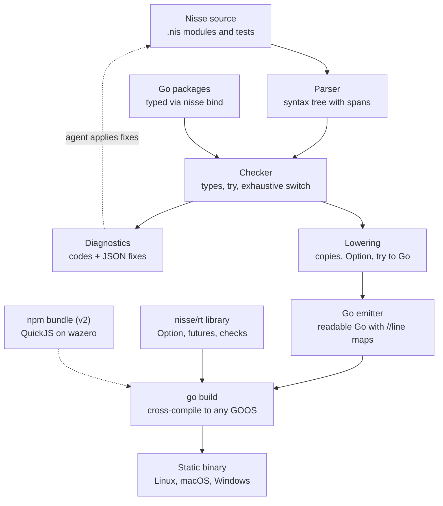

# Nisse: TypeScript-shaped language on Go — PRD & build plan

Oct 19, 2026

## Summary

Nisse is a strict, TypeScript-shaped language for coding agents that compiles to readable Go and ships as a single static binary. It keeps the agent-friendly ideas proven by [Tov](https://github.com/richiemcilroy/Tov): familiar TS syntax, no `any`/`null`/`==`, every fallible call marked `try`, and compiler errors that return machine-applicable fixes. Unlike Tov, it does not own a native runtime. Go provides the GC, scheduler, networking, TLS and cross-compilation.

The bet: agents write TypeScript well, Go runs servers well, and the missing piece is a strict checker with agent-readable diagnostics in between. v1 targets backend services and CLIs. Go packages are first-class imports; npm is an opt-in escape hatch through an embedded JS engine.

## Problem and opportunity

Agents produce a lot of backend code, and the languages they write best are the ones that fail most quietly. TypeScript allows `any`, implicit coercion and unmarked throws. Errors come back as prose an agent has to interpret, so fix loops are slow and guessy. Go is strict and operationally excellent, but agents write it less fluently, and its error handling is verbose enough that they cut corners.

Tov shows the demand for a middle path (about 700 GitHub stars at version 0.0.1). It also shows the cost: a custom C runtime, its own HTTP server and TLS integration, and an embedded JavaScriptCore. That is a large surface to keep correct and secure, and it does not run on Windows yet.

Nisse takes the same front end and hands the back end to Go:

- **Production runtime for free.** Go's scheduler, GC, `net/http`, TLS, pprof and race detector are mature and memory-safe.
- **Distribution for free.** `GOOS`/`GOARCH` cross-compilation covers Linux, macOS and Windows from one machine.
- **Ecosystem for free.** Every Go module becomes a typed import.
- **Trade-off accepted.** Lower peak throughput and higher memory than a hand-tuned C runtime, and no drop-in npm compatibility.

## Goals, non-goals and users

**Primary user:** a developer who has a coding agent write and maintain backend services and CLIs, and who wants the output to be safe, fast and easy to deploy. **Secondary user:** the agent itself, which consumes the docs, diagnostics and fixes.

**Goals for v1**

1. An agent with no prior exposure writes correct Nisse from a single `llms.txt` spec.
2. Every compile error has a stable code, and most common ones ship a machine-applicable fix.
3. Generated Go is readable, idiomatic enough to debug, and maps back to Nisse source lines.
4. HTTP services and CLIs build to one static binary for Linux, macOS and Windows.
5. Any Go package can be imported with types, without hand-written bindings.

**Non-goals for v1**

- Running arbitrary npm packages or Bun/Node apps unchanged.
- Beating Go or Rust on raw benchmarks.
- Frontend, browser or WASM-in-the-browser targets.
- A package manager of its own (Go modules are the package manager).
- Full TypeScript compatibility: anything that makes code hard to reason about stays out.

## Language requirements

Nisse keeps TypeScript's syntax and drops what makes programs hard to reason about. Each feature below has a defined Go lowering; anything without one is out of v1.

| Nisse feature | Rule | Lowers to Go |
| --- | --- | --- |
| `int`, `f64`, `string`, `bool` | `int` and `f64` are distinct; overflow traps | `int64`, `float64`, `string`, `bool`; checked arithmetic helpers |
| Records `{ a: int }` | Value semantics: assignment copies | Structs, passed by value; deep copy for nested slices/maps |
| Arrays `T[]`, `Map<K,V>` | Value semantics; copy on assign | Slices and maps wrapped with copy-on-assign; compiler elides copies it can prove unneeded |
| Classes | Reference semantics, GC'd | Pointer to struct plus methods |
| Interfaces | Structural | Go interfaces (structural already) |
| Unions with a `kind` tag | Must narrow; `switch` must be exhaustive | Sealed interface + one struct per variant; type switch |
| Optional `T \| undefined` | No `null`; must narrow | `Option[T]` generic struct |
| `try f()` / `throws E` | Fallible calls marked; errors part of the type | `(T, error)` returns with typed error values; `try` = early return |
| `try { } catch (e) { }` | Catch by error type | `errors.As` chain |
| Generics (functions, types) | No generic methods on classes in v1 | Go type parameters |
| `async`/`await`, `Promise<T>` | Structured concurrency | Goroutine + typed channel future; `Promise.all` = errgroup |
| `inout` params, `&x` | Explicit mutation of caller's value | Pointer parameters |
| Modules `import`/`export` | One Nisse module = one Go package | Package per directory, exported names capitalised |
| `test("…", () => …)` | Built-in tests | Generated `_test.go` functions |

**Removed from TypeScript:** `any`, `null`, `==`/`!=`, implicit coercion, `var`, prototypes, decorators, `enum` (use unions), declaration merging, getters/setters with side effects, `eval`.

**Source mapping:** every generated Go file carries `//line` directives, so panics, stack traces, `go vet` output and the debugger point at Nisse lines.

## Toolchain and agent-facing requirements

The diagnostics are the product: every requirement here serves a tight write → check → fix loop for agents.

**CLI (`nisse`)**

| Command | Does |
| --- | --- |
| `nisse check [path] [--json]` | Type-check only; JSON diagnostics for tools |
| `nisse fix [path] [--safe-only]` | Apply machine-applicable fixes |
| `nisse explain E0831` | Long-form explanation and examples for an error code |
| `nisse run file.nis` | Build and run `main()` |
| `nisse build -o app [--target linux/arm64]` | Emit Go, invoke `go build`, write one binary |
| `nisse test` | Run `test(...)` blocks via `go test` |
| `nisse emit` | Write the generated Go for inspection |
| `nisse bind <go-module>` | Generate typed Nisse declarations for a Go package |
| `nisse --watch` | Rebuild and restart on change |

**Diagnostics contract**

- Stable codes (`E` + 4 digits), never reused. Each has an `explain` page.
- Human output: location, message, one-line why, alternatives.
- JSON output: `code`, `file`, `start`/`end`, `message`, and `fixes[]` with `label`, `applicability` (`safe` | `maybe` | `manual`) and exact text `edits[]`.
- Errors in generated Go are a compiler bug, never user-facing. CI enforces this.
- Check of a 10k-line project returns in under 500 ms.

**Agent docs**

- `llms.txt`: the spec written as diffs from TypeScript plus the command guide, kept under ~15k tokens so it fits in any agent's context.
- An `AGENTS.md` template users drop into repos.
- A language server (LSP) built on the same checker, so humans get the same fixes as quick-actions.

## Interop

Go packages are the default library story; npm is an opt-in escape hatch for pure-JS packages only.

**Go packages (v1, first-class)**

- `import { Router } from "go:github.com/go-chi/chi/v5"` and `import { readFile } from "go:os"`.
- `nisse bind` reads Go signatures and emits Nisse declarations: `(T, error)` becomes `throws`, pointers to structs become classes, `nil`-able returns become `Option[T]`.
- A curated standard library (`nisse:http`, `nisse:fs`, `nisse:json`, `nisse:process`) wraps Go's stdlib with TS-familiar names, so agents can lean on what they already know.

**npm packages (v2, opt-in)**

- Engine: QuickJS compiled to WASM, run with wazero. This keeps builds cgo-free and cross-compilable. goja is the fallback if WASM overhead is too high.
- Scope: pure-JS ESM/CJS packages (validators, date libraries, utility libraries). Bundled at build time and embedded in the binary.
- Out of scope: Node-API native addons, packages needing `worker_threads`, raw sockets or child processes.
- Values from JS have type `Js` and are checked on conversion (`as T`); every call into JS is `try`.
- A pool of engine instances, one per worker goroutine, because JS engines are single-threaded.
- A minimal Node shim (`Buffer`, `URL`, `TextEncoder`, `crypto.randomUUID`, timers) implemented in Go, grown by demand.

## Architecture

Nisse is a source-to-source compiler: almost all engineering effort goes into the checker and its diagnostics, and everything after lowering is handed to Go's toolchain.

The agent loop (check, fix, re-check) never touches Go; Go packages enter as typed declarations, and the small `nisse/rt` library and the optional npm bundle are linked at build time.

## Success metrics

The headline metric is how often an agent gets from a task to a passing build without a human. All targets below are proposals to validate during Phase 1.

| Metric | How measured | v1 target |
| --- | --- | --- |
| Agent task success | Fixed suite of 50 backend tasks, agent given only `llms.txt` | ≥ 80% pass with tests |
| Fix-loop length | Median `check` → `fix` iterations to a clean build | ≤ 2 |
| Fix coverage | Share of emitted diagnostics with a `safe` fix | ≥ 60% |
| Generated-Go errors | `go build` failures on code that passed `nisse check` | 0 in CI |
| Check latency | 10k-line project, warm | < 500 ms |
| HTTP throughput | JSON route vs hand-written Go `net/http` | ≥ 90% of Go |
| Binary size | Hello-world HTTP server, stripped | Within 10% of plain Go |
| Adoption | GitHub stars, weekly active installs | Tracked from launch, no target yet |

## Build plan

The public 0.1 lands after Phase 3, about 18 weeks in; npm interop follows only if the task suite says users need it. Week counts are estimates for one full-time builder working with a coding agent; the gates, not the dates, decide when a phase ends.

| Phase | Weeks | Scope | Gate to move on |
| --- | --- | --- | --- |
| 0 · Spike | 1–2 | Tiny subset to Go: functions, records, loops; hello-world HTTP server through `net/http` | Binary builds on Linux, macOS, Windows |
| 1 · Core language | 3–8 | Checker, unions, `try`/`throws`, generics, value semantics, `//line` maps; diagnostics with codes and JSON; 50-task agent suite v0 | Suite at 60% pass; no generated-Go errors |
| 2 · Agent toolchain | 9–12 | Safe fixes, `nisse fix`, `nisse explain`, `llms.txt`, `AGENTS.md` template; language server, `--watch`, `test()` via `go test` | Median fix loop of 2; 60% safe-fix coverage |
| 3 · Servers and Go interop | 13–18 | `async`/`await` on goroutines; `nisse:http`, `nisse:fs`, `nisse:json`; `nisse bind`; benchmarks against plain Go | **Public 0.1 release:** suite 80%, HTTP 90% of Go |
| 4 · npm escape hatch | 19–24 | QuickJS on wazero, engine pool, `Js` type, minimal Node shim; pure-JS packages only | 20 popular pure-JS packages pass tests |

**First two weeks (Phase 0)**

- [ ] Write the 10-line spec for the spike subset and 5 sample programs
- [ ] Lexer and parser for the subset, in Go, with source spans on every node
- [ ] Lower functions, records, `if`/`for` and `console.log` to Go via `go/ast`; print with `go/format`
- [ ] Emit `//line` directives and confirm a panic points at the `.nis` line
- [ ] `nisse run` and `nisse build --target` wrapping `go build`
- [ ] Hello-world HTTP server cross-compiled for Linux, macOS and Windows
- [ ] Set up CI with golden tests for emitted Go
- [ ] Draft the first 10 tasks of the agent suite

## Risks and decisions

| Risk | Impact | Mitigation |
| --- | --- | --- |
| Value semantics for arrays/maps cost too much in Go | Slow code, memory churn | Copy-on-write wrappers; escape analysis in the checker to elide copies; benchmark in Phase 1 |
| `async`/`await` on goroutines leaks or deadlocks | Hard-to-debug servers | Structured concurrency only: no detached tasks without an explicit `spawn`; context cancellation built in |
| Generated Go is unreadable | Users can't debug or trust it | `nisse emit` golden tests; readability review per release; `//line` mapping |
| Go's lack of generic methods blocks TS idioms | Spec gaps agents trip on | Lower to free functions; document clearly in `llms.txt` |
| Tov or a big player ships the same thing | Reduced differentiation | Lead on Go interop and Windows; keep the diagnostics contract compatible in spirit |
| npm demand outweighs Go-first story | Adoption stalls | Ship Phase 4 early as a preview if task-suite data shows npm is the top blocker |

**Decisions**

- [ ] Name: Nisse. Secure the GitHub org, domain and Go module path (only a Maven build plugin shares the name; no language does).
- [x] Compiler implementation language: Go. Contributors need one language, `nisse bind` reads Go packages directly through `go/types` and `go/packages`, and the tool installs with `go install`. TypeScript's own compiler is being ported to Go for speed, so the 500 ms check target is realistic.
- [x] Integers: `int` is always 64-bit (Go `int64`) and is the default. Sized types `i8`–`i64` and `u8`–`u64` exist for Go interop and byte work, and `nisse bind` maps Go's sized types onto them. Overflow traps for every integer type.
- [x] Codegen: build Go as `go/ast`, print it with `go/format` and write files; no separate plugin path. Later, hand generated files to `go build -overlay` to skip disk writes.
- [x] License: MIT. QuickJS (MIT) and wazero (Apache-2.0) are compatible for the npm phase.
