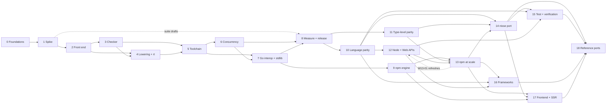

# Nisse work ledger

Every piece of work needed to ship Nisse v1 and then the TypeScript parity line (reproducing complex TypeScript apps on the Go runtime), grouped into waves. The [PRD](../PRD.md) says *what* and *why*; this ledger says *what's left*, in what order, and when each item is done.

## Waves

| Wave | File | PRD phase | Gate (from the PRD) |
| --- | --- | --- | --- |
| 0 · Foundations | [wave-0-foundations.md](wave-0-foundations.md) | 0 · Spike | Repo builds and tests on Linux, macOS, Windows in CI |
| 1 · Spike | [wave-1-spike.md](wave-1-spike.md) | 0 · Spike | Hello-world HTTP binary builds on Linux, macOS, Windows |
| 2 · Front end | [wave-2-frontend.md](wave-2-frontend.md) | 1 · Core language | Whole grammar parses; diagnostics infrastructure in place |
| 3 · Checker | [wave-3-checker.md](wave-3-checker.md) | 1 · Core language | Every rule in PRD [Semantics](../PRD.md#semantics) enforced, with tests |
| 4 · Lowering and runtime | [wave-4-lowering.md](wave-4-lowering.md) | 1 · Core language | Nisse at or above the Go baseline; no generated-Go errors; benchmarks done |
| 5 · Agent toolchain | [wave-5-toolchain.md](wave-5-toolchain.md) | 2 · Agent toolchain | Median fix loop of 2; 60% safe-fix coverage |
| 6 · Concurrency | [wave-6-concurrency.md](wave-6-concurrency.md) | 3 · Servers and Go interop | Structured async works and doesn't leak |
| 7 · Go interop and stdlib | [wave-7-interop-stdlib.md](wave-7-interop-stdlib.md) | 3 · Servers and Go interop | Popular Go modules usable through `nisse bind` |
| 8 · Measurement and release | [wave-8-measure-release.md](wave-8-measure-release.md) | 1 → 3b (runs alongside) | **Public 0.1 preview:** 25-task suite at or above Go with confidence intervals, HTTP 90% of Go; 0.2 adds the TypeScript baseline |
| 9 · npm escape hatch | [wave-9-npm.md](wave-9-npm.md) | 4 · npm escape hatch | 20 popular pure-JS packages pass tests |
| 10 · Language parity | [wave-10-language-parity.md](wave-10-language-parity.md) | 5 · Language parity | PRD [Language additions](../PRD.md#language-additions) done; built-in fidelity ≥ 95% |
| 11 · Type-level parity | [wave-11-type-level-parity.md](wave-11-type-level-parity.md) | 5 · Language parity | `compat` code checks with TypeScript 7 and lowers for the tier 1 and 1b apps |
| 12 · Node and Web APIs | [wave-12-node-web-apis.md](wave-12-node-web-apis.md) | 6 · Runtime and npm parity | Ported Node tests ≥ 90% per module |
| 13 · npm at scale | [wave-13-npm-at-scale.md](wave-13-npm-at-scale.md) | 6 · Runtime and npm parity | Every tier 1 dependency has a working track |
| 14 · `nisse port` | [wave-14-port-tool.md](wave-14-port-tool.md) | 7 · Porting | Tier 1 app ported; automation ≥ 90% |
| 15 · Test and verification | [wave-15-test-verification.md](wave-15-test-verification.md) | 7 · Porting | Original tests run; zero unexplained replay differences |
| 16 · Frameworks | [wave-16-frameworks.md](wave-16-frameworks.md) | 8 · Frameworks | Tier 2 backend passes its tests |
| 17 · Frontend and SSR | [wave-17-frontend-ssr.md](wave-17-frontend-ssr.md) | 9 · Frontend and SSR | Tier 2 React renders in Go and hydrates; tier 3 as one binary plus its media tools |
| 18 · Reference ports | [wave-18-reference-ports.md](wave-18-reference-ports.md) | 7 → 9 (one tier per phase) | Tier 3 shipped as one binary, tests passing |

Open and proposed decisions live in [decisions.md](decisions.md).

## Order of work

**Release lines.** Waves 0–8 are v1: the public 0.1 preview after PRD phase 3, then the `(0.2)` items in phase 3b (D-33). Waves 9–18 are the parity line; nothing in it starts before 0.1 except design notes. Wave 18 runs across phases 7–9: each tier's port is the gate of its phase.

Waves 3 and 4 move together one feature at a time: a feature is done when it is checked, lowered, golden-tested and run end to end, not when one side is written. Wave 8's harness and baselines start during Phase 1, because the Phase 1 gate needs them. Likewise W15-01 (the Jest-compatible test API) starts in Phase 6, because compat packages port their tests with it.

## How to use it

- **IDs** are `W<wave>-<nn>`, for example `W3-12`. They are never renumbered or reused. New items get the next free number in their wave.
- **Status** is the checkbox: `[ ]` to do, `[x]` done. Mark work in progress by adding `— in progress (who)` to the item's line.
- **Each item** has a one-line title, *Needs* (the items it depends on) and *Done when* (the acceptance check). An item without a testable *Done when* isn't ready to start.
- **Dropped items** are struck through (`~~W4-07~~`) with a one-line reason, not deleted.
- **New work found while building** is added here first, then done. If it changes behaviour the PRD describes, update the PRD in the same change.
- Items marked **(proposed)** are not yet in the PRD; they need a decision in [decisions.md](decisions.md) before they start.
- Items marked **(0.2)** are part of v1 but come after the public 0.1 preview (D-33), in PRD phase 3b.
