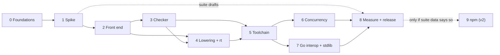

# Nisse work ledger

Every piece of work needed to ship Nisse v1 (and the v2 npm phase), grouped into waves. The [PRD](../PRD.md) says *what* and *why*; this ledger says *what's left*, in what order, and when each item is done.

## Waves

| Wave | File | PRD phase | Gate (from the PRD) |
| --- | --- | --- | --- |
| 0 · Foundations | [wave-0-foundations.md](wave-0-foundations.md) | 0 · Spike | Repo builds and tests on Linux, macOS, Windows in CI |
| 1 · Spike | [wave-1-spike.md](wave-1-spike.md) | 0 · Spike | Hello-world HTTP binary builds on Linux, macOS, Windows |
| 2 · Front end | [wave-2-frontend.md](wave-2-frontend.md) | 1 · Core language | Whole grammar parses; diagnostics infrastructure in place |
| 3 · Checker | [wave-3-checker.md](wave-3-checker.md) | 1 · Core language | Every rule in PRD [Semantics](../PRD.md#semantics) enforced, with tests |
| 4 · Lowering and runtime | [wave-4-lowering.md](wave-4-lowering.md) | 1 · Core language | Suite at 60%; no generated-Go errors; benchmarks done |
| 5 · Agent toolchain | [wave-5-toolchain.md](wave-5-toolchain.md) | 2 · Agent toolchain | Median fix loop of 2; 60% safe-fix coverage |
| 6 · Concurrency | [wave-6-concurrency.md](wave-6-concurrency.md) | 3 · Servers and Go interop | Structured async works and doesn't leak |
| 7 · Go interop and stdlib | [wave-7-interop-stdlib.md](wave-7-interop-stdlib.md) | 3 · Servers and Go interop | Popular Go modules usable through `nisse bind` |
| 8 · Measurement and release | [wave-8-measure-release.md](wave-8-measure-release.md) | 1 → 3 (runs alongside) | **Public 0.1:** suite 80% and baseline targets, HTTP 90% of Go |
| 9 · npm escape hatch | [wave-9-npm.md](wave-9-npm.md) | 4 · npm (v2) | 20 popular pure-JS packages pass tests |

Open and proposed decisions live in [decisions.md](decisions.md).

## Order of work

Waves 3 and 4 move together one feature at a time: a feature is done when it is checked, lowered, golden-tested and run end to end, not when one side is written. Wave 8's harness and baselines start during Phase 1, because the Phase 1 gate needs them.

## How to use it

- **IDs** are `W<wave>-<nn>`, for example `W3-12`. They are never renumbered or reused. New items get the next free number in their wave.
- **Status** is the checkbox: `[ ]` to do, `[x]` done. Mark work in progress by adding `— in progress (who)` to the item's line.
- **Each item** has a one-line title, *Needs* (the items it depends on) and *Done when* (the acceptance check). An item without a testable *Done when* isn't ready to start.
- **Dropped items** are struck through (`~~W4-07~~`) with a one-line reason, not deleted.
- **New work found while building** is added here first, then done. If it changes behaviour the PRD describes, update the PRD in the same change.
- Items marked **(proposed)** are not yet in the PRD; they need a decision in [decisions.md](decisions.md) before they start.
